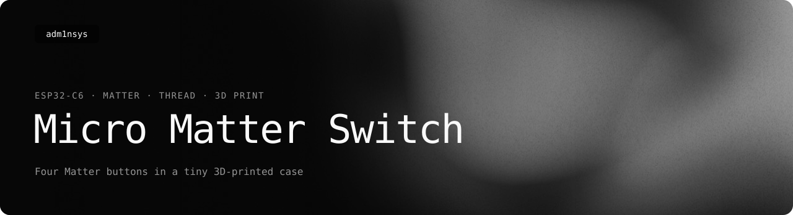
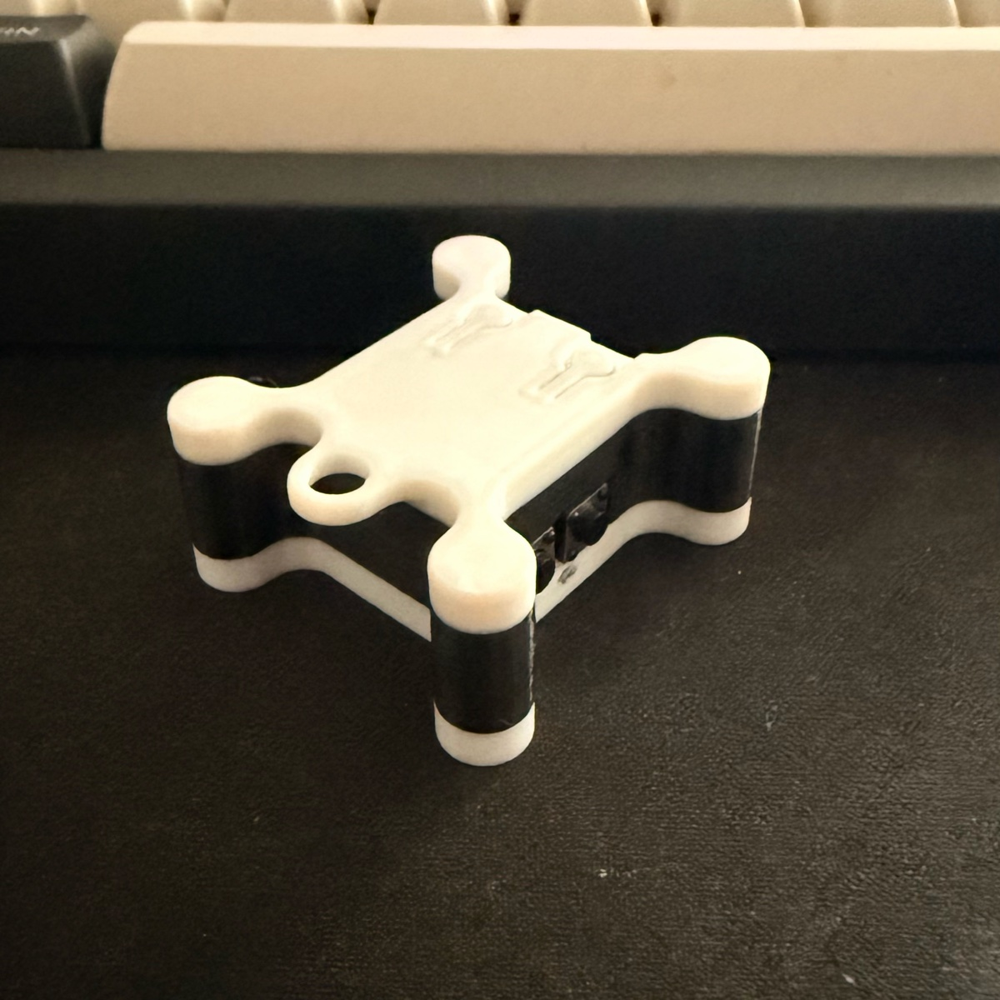
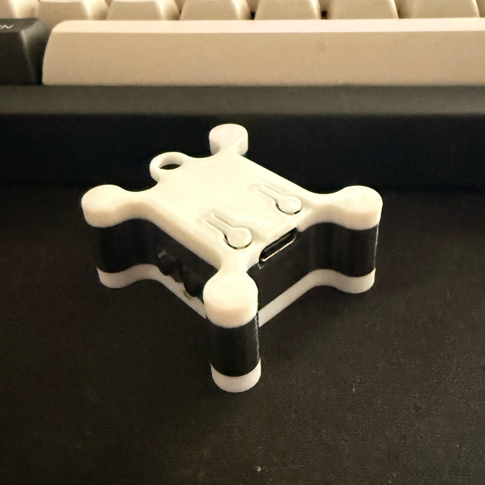
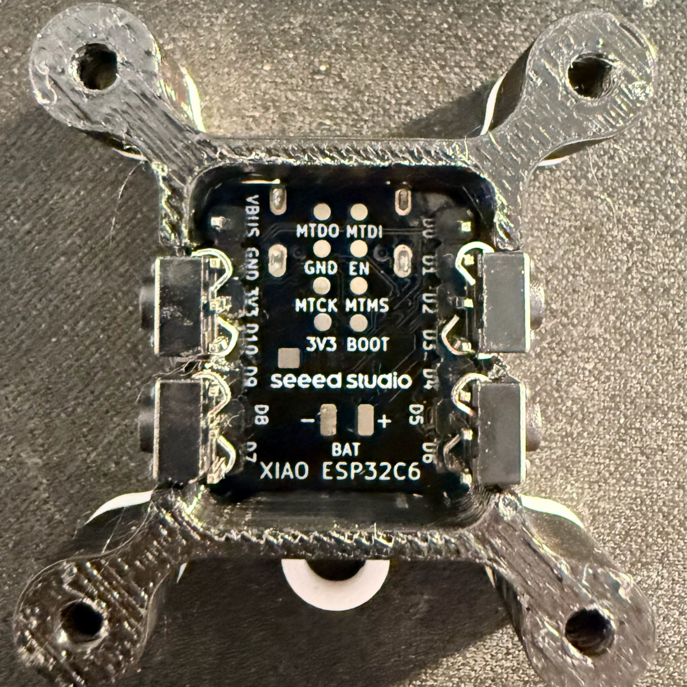
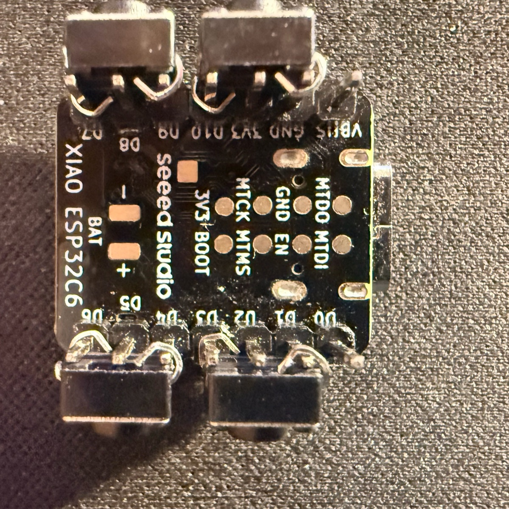
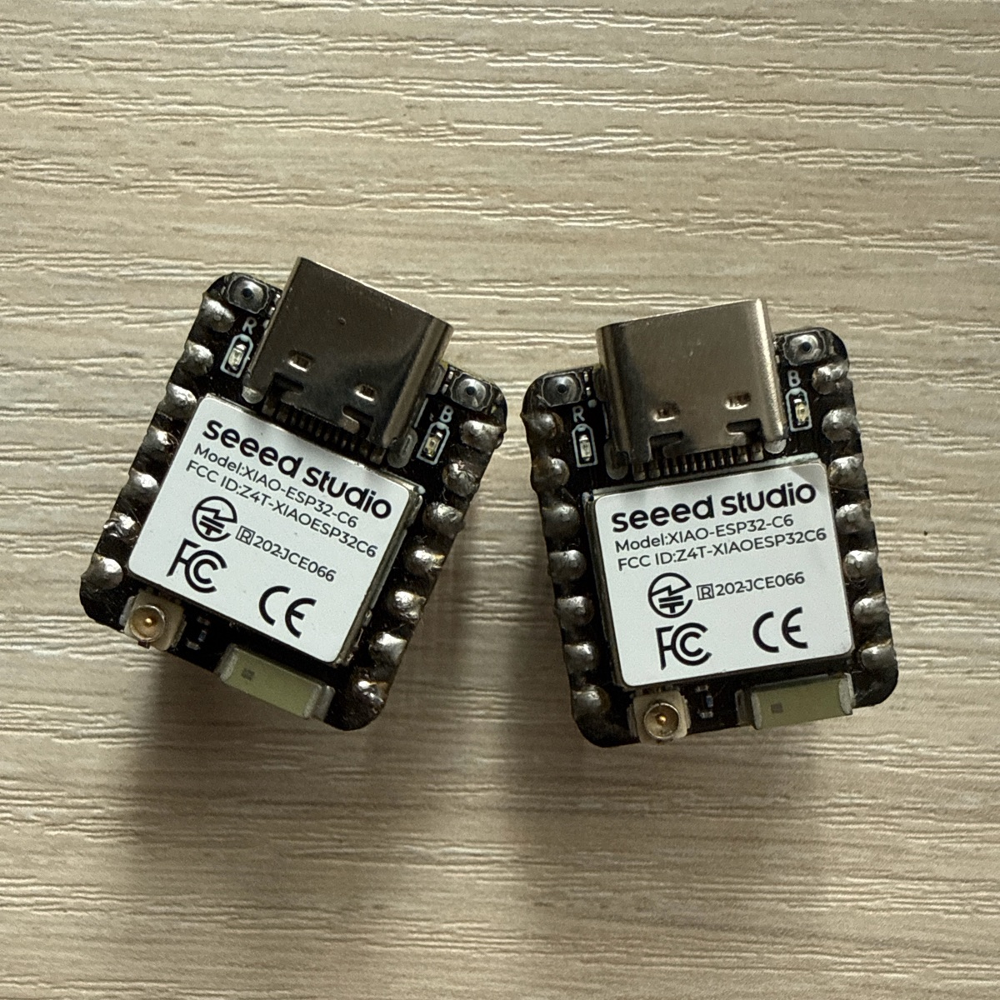
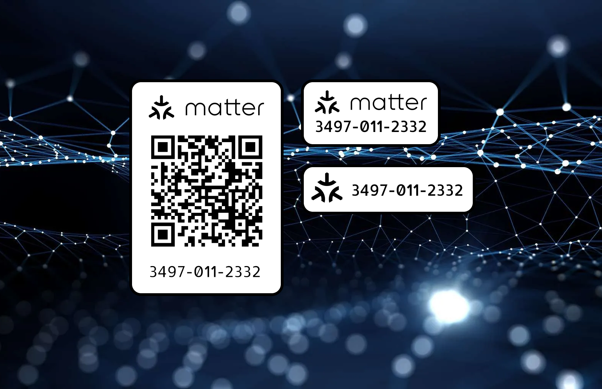

<picture>
  <source media="(prefers-color-scheme: light)" srcset=".github/readme/banner-light.svg">
  
</picture>

  
  
  
  

**Micro Matter Switch (MMS)** is a small Matter switch on a [Seeed XIAO ESP32-C6](https://wiki.seeedstudio.com/xiao_esp32c6_getting_started/)
in a 3D-printed case. Four buttons show up in Apple Home, Google Home and Alexa as Matter buttons for automations,
plus one switchable output — over Thread, set up via Bluetooth.

Designed and written by [adm1nsys](https://github.com/adm1nsys) on top of the
[Matter library of Espressif's Arduino core](https://github.com/espressif/arduino-esp32/tree/master/libraries/Matter).
It is built as a **constructor**: every Matter device is a small module, and a new one is a new file plus one line in
[`DeviceImport.h`](DeviceImport.h) — the switch here is one set of modules.

## What it is

  
  

- **Four buttons** as Matter buttons: a press runs an automation in the Home app.
- **One output** (an on/off light in Matter) for a relay or an LED; its state survives a restart.
- **Matter over Thread**, commissioned over Bluetooth. A Wi-Fi variant is prepared: `BLE_MODE 0` in [`variables.h`](variables.h).
- The XIAO ESP32-C6 because it is really tiny. Other ESP32 boards work too, with their own pins and their own case.

## Wiring

| | Input (pull-up) | Other side of the button |
|---|---|---|
| Button 1 | GPIO 18 (D10) | GND |
| Button 2 | GPIO 17 (D7) | GPIO 20 (D9), driven LOW |
| Button 3 | GPIO 1 | GPIO 21 (D3), driven LOW |
| Button 4 | GPIO 22 (D4) | GPIO 16 (D6), driven LOW |
| Output | GPIO 21 | relay or LED, active LOW |

Button 3 and the output both use GPIO 21 in the current code — if you use both, move one of them.

The buttons are ordinary four-leg tactile switches with two diagonally opposite legs broken off; the remaining legs wrap
around the board's pins. In one row: broken, whole, broken; in the other: whole, broken — mirrored on the second side.
That is what makes it fit the small case.

  
  
  

## Case

Two parts in [`Case/`](Case) — base and lid — for M3×12 screws: `CaseESP.stl`, `CaseESPtop.stl`, and the Fusion file
`CaseESP.f3z` for changes. PETG works well: easy to print, strong enough, many colours.

## Flashing

1. Install the [Arduino IDE](https://www.arduino.cc/en/software/) — not Arduino App Lab.
2. In Preferences, add the board manager URL `https://espressif.github.io/arduino-esp32/package_esp32_index.json`.
3. Install the **esp32** package and pick **XIAO_ESP32C6** as the board. Install **esp32 3.3.0** in the Boards Manager. Newer versions removed an API the code uses and fail to compile.
4. Open `Micro-Matter-Switch.ino` and upload (⌘U / Ctrl+U). The Arduino IDE wants the folder to have the same name as the sketch: a ZIP download unpacks as `Micro-Matter-Switch-main`, so rename it to `Micro-Matter-Switch` first. [`build_opt.h`](build_opt.h) next to the sketch switches the build to Thread.

My board settings (*Tools* menu):

| Setting | Value |
|---|---|
| USB CDC On Boot | Enabled |
| CPU Frequency | 160MHz (WiFi) |
| Core Debug Level | Verbose |
| Erase All Flash Before Sketch Upload | Enabled |
| Flash Frequency | 80MHz |
| Flash Mode | QIO |
| Flash Size | 4MB (32Mb) |
| JTAG Adapter | Disabled |
| Partition Scheme | Huge APP (3MB No OTA/1MB SPIFFS) |
| Upload Speed | 115200 |
| Zigbee Mode | Zigbee ED (end device) |

The same in the Arduino IDE:

## Pairing

In Apple Home, Google Home or Alexa choose *Add device* and scan the QR code or enter **3497-011-2332**
(the Matter SDK's standard test code).

Holding any of the four buttons or BOOT for five seconds resets the pairing. While the device is not paired, the LED blinks.

## How the code is laid out

| File | |
|---|---|
| [`Micro-Matter-Switch.ino`](Micro-Matter-Switch.ino) | start-up, Matter, pairing and the loop |
| [`DeviceImport.h`](DeviceImport.h) | the list of Matter devices — each is a module with three functions (before start, after start, in the loop); a new device is a new file and one line here |
| [`MatterButtons/`](MatterButtons) | the four buttons |
| [`MatterOnOffLight/`](MatterOnOffLight) | the output |
| [`custom_connect.h`](custom_connect.h) | your own actions on pairing, reset and a BOOT press |
| [`variables.h`](variables.h) | pins, timings, BLE or Wi-Fi mode |

## License

[Apache-2.0](LICENSE).
